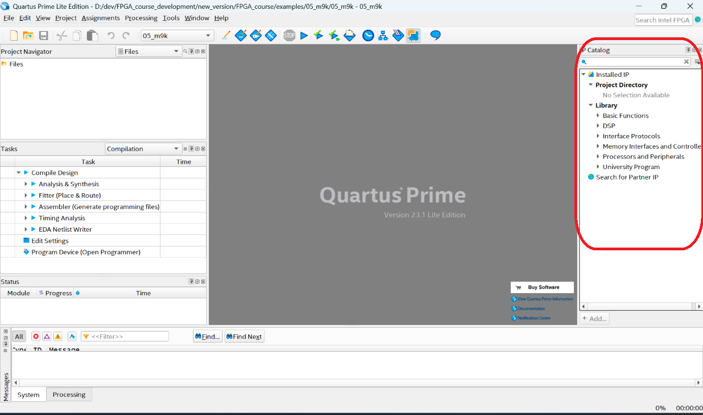
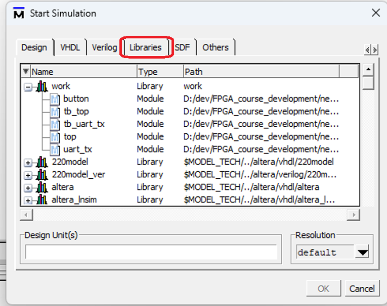
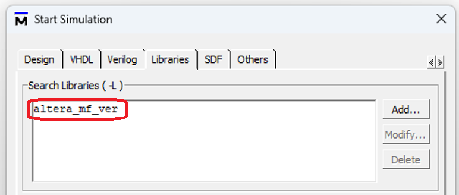

# Пример использования блоков памяти M9K
Пример создания и использования IP памяти.

# Цель проекта
Наша цель читать ROM память, в которой записаны 4-битные слова, обозначающие патерны включеных/выключенных диодов, и зажигать диоды в соответствие с прочитанным значением.

# Создание IP
(Для проверки можете использовать модуль rom.v включенный в пример, но затем сами пересоздайте этот модуль по инструкции ниже)
используйте IP Catalog (обычно он находится справа).

Найдите "ROM: 1-PORT" и создайте ее.
Для данной памяти используйте:
* имя: "rom"
* ширину шины q: 4
* глубину памяти (How many 4-bit words of memory?): 10
* memory block type: M9K
* в качестве содержимого памяти используйте rom.mif

# Симуляция
Для симуляции в modelsim добавьте библиотеку altera_mf_ver.
Для симуляции другими симуляторами в список файлов добавьте "altera_mf.v".
Например:
`iverilog -g2012 -s tb_ram -o build/ram.vvp tb_ram.sv your_design.v ram_ip.v “<Quartus path>/20.1/quartus/eda/sim_lib/altera_mf.v"`

